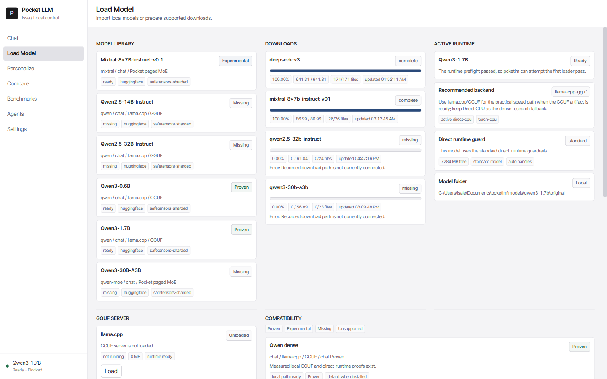

# PocketLM

An experimental local LLM runtime and workbench for Windows.

PocketLM explores how to run open-weight models when memory and compute are limited: importing model files, choosing an available backend, streaming weights from disk, managing caches and measuring execution. The repository includes Python runtime code, native C++ kernels, a local app and tests.

**Status:** earlier experimental project, not currently under active development. This repository preserves the research source. Model coverage and performance vary by backend.



## Three execution paths

| Path | Purpose | Main code |
|---|---|---|
| Direct CPU | Python/Torch execution with native C++ helpers, tensor loading and residency management. | [Runtime code](src/pcketlm/core/runtime/), [native kernels](src/pcketlm/native/) |
| GGUF / llama.cpp | Manage a local llama.cpp backend for compatible GGUF models. llama.cpp supplies inference on this path. | [GGUF adapter](src/pcketlm/core/runtime/gguf_backend.py) |
| FP8 streaming | Explore disk-backed execution and multi-token prediction for DeepSeek-V3 weights that exceed available RAM. | [FP8 runtime](src/pcketlm/core/runtime/fp8_source.py), [speculative decoding](src/pcketlm/core/runtime/speculative.py) |

The [engine selector](src/pcketlm/core/runtime/engine_selector.py) reports installed backends, memory and blockers. Detecting a GPU does not mean a complete GPU execution path is implemented.

## What is in the repository

- Model intake and inspection for local model sources, plus a registry and runtime profiles.
- Tensor catalogs, execution plans and hot/warm residency windows for streaming weights.
- C++ helpers for FP8/FP16 operations, attention, KV caches, packed GEMV and dequantization.
- Speculative-decoding experiments with counters for layer execution and accepted tokens.
- A web UI, desktop status screen and command-line diagnostics.
- Unit, contract and kernel tests, with a small portable suite in Windows CI.

Model weights, downloaded runtimes, compiled binaries, runtime state and generated benchmark artifacts are excluded. See the [public source manifest](docs/privacy.md).

## Model coverage

The project's recorded work distinguishes real-weight experiments from fixture checks:

| Family | Recorded scope |
|---|---|
| Qwen dense models | Local chat and benchmark experiments through direct and GGUF paths. |
| DeepSeek-V3 | Full-model FP8 CPU experiments; generation remains slow and requires substantial local storage. |
| Qwen MoE and Mixtral | Experimental paged-expert runtime. |
| Gemma 3 and Kimi K2 | Chat contracts checked against fixtures; broader real-weight validation is still needed. |
| Kronos | A forecasting adapter with fixture checks, separate from the chat-model paths. |

Support for a family is not a guarantee that every model, revision or quantization in that family will run.

## Run locally

Use Windows and Python 3.12 or newer. Install dependencies and provide compatible model files separately; the repository contains no model weights.

```powershell
git clone https://github.com/useralx01/PocketLM.git
cd PocketLM
.\install-pocketlm.ps1 -StartApp
```

The installer creates an isolated environment under `%LOCALAPPDATA%\PocketLM\venvs`, installs the project and runs the installation health check. Add a supported local model through the app's Models screen. A compatible GGUF file and an installed llama.cpp runtime are needed for the GGUF path.

Relaunch the app with:

```powershell
.\start-pocketlm.ps1
```

The local web app defaults to `127.0.0.1:8765` and can select another local port if that port is occupied. Dependency installation and any model downloads require network access; local inference uses the selected local backend and files.

### Native kernels

The native build script expects Visual Studio 2022 C++ Build Tools at its default Windows location. Building all kernels also requires OpenBLAS headers, library and DLL under `vendor/openblas`; these files are not included.

```powershell
py -3.12 tools/build_native.py --force
```

See [tools/build_native.py](tools/build_native.py) for the expected paths and compiler flags. Hardware-specific kernels require compatible CPU instruction support.

## Tests and recorded measurements

For development, create a separate environment and run the same portable contract modules selected by [Windows CI](.github/workflows/windows-smoke.yml):

```powershell
py -3.12 -m venv .venv
.\.venv\Scripts\python.exe -m pip install -e . pytest
.\.venv\Scripts\python.exe -m pytest -q tests/test_supervisor.py tests/test_model_compatibility.py tests/test_kronos_backend.py
```

The broader suite contains tests that depend on local tensor fixtures, models or native components. Those prerequisites are not all included in the public snapshot. Passing the portable suite checks its covered contracts; it does not reproduce full-model performance or prove support for every advertised architecture.

[BENCHMARKS.md](BENCHMARKS.md) preserves the project's recorded local experiments, including Qwen chat, DeepSeek-V3 streaming, rejected optimizations and a GPU probe. The raw generated proof files are not published here, and the hardware description is incomplete. Treat those figures as historical project measurements, not independently reproduced results or a speed guarantee on another computer. The managed llama.cpp results and the custom runtime results describe different execution paths.

## Limitations and useful next work

- Publish sanitized benchmark artifacts with exact hardware, software versions, settings and cold/warm conditions.
- Reproduce representative model runs on more than one machine.
- Validate model families currently covered only by fixtures using real weights.
- Complete and validate the GPU path before describing it as available acceleration.
- Improve installation diagnostics for missing weights, runtimes and native libraries.

## Code map

| Path | Contents |
|---|---|
| [src/pcketlm/core/runtime/](src/pcketlm/core/runtime/) | Backends, loading, streaming, residency and speculative decoding |
| [src/pcketlm/core/model_import/](src/pcketlm/core/model_import/) | Model intake, inspection and packing |
| [src/pcketlm/native/](src/pcketlm/native/) | Native C++ helpers |
| [src/pcketlm/app/](src/pcketlm/app/) | Web UI, desktop status and CLI tools |
| [tools/](tools/) | Benchmark, diagnostic and build entry points |
| [tests/](tests/) | Test suite |
| [docs/design/](docs/design/) | Design notes and development plans; some reflect earlier milestones |

## Author and license

Developed by [Issa Alexandre Tagro](https://github.com/useralx01) with AI-assisted development tools. PocketLM uses existing libraries and backends, including PyTorch and llama.cpp where selected.

[MIT](LICENSE). Model weights and external dependencies retain their own licenses.
